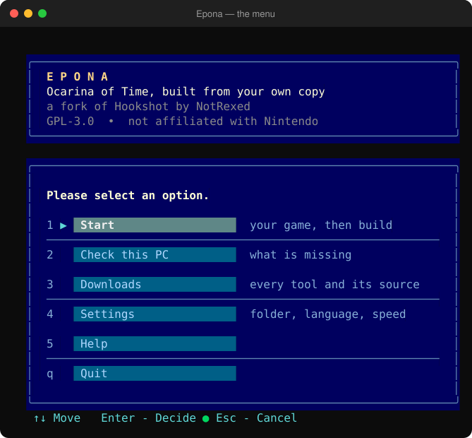
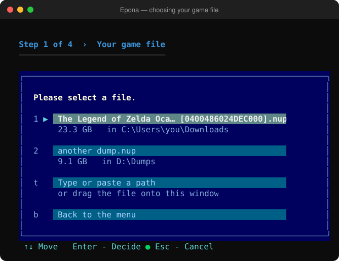
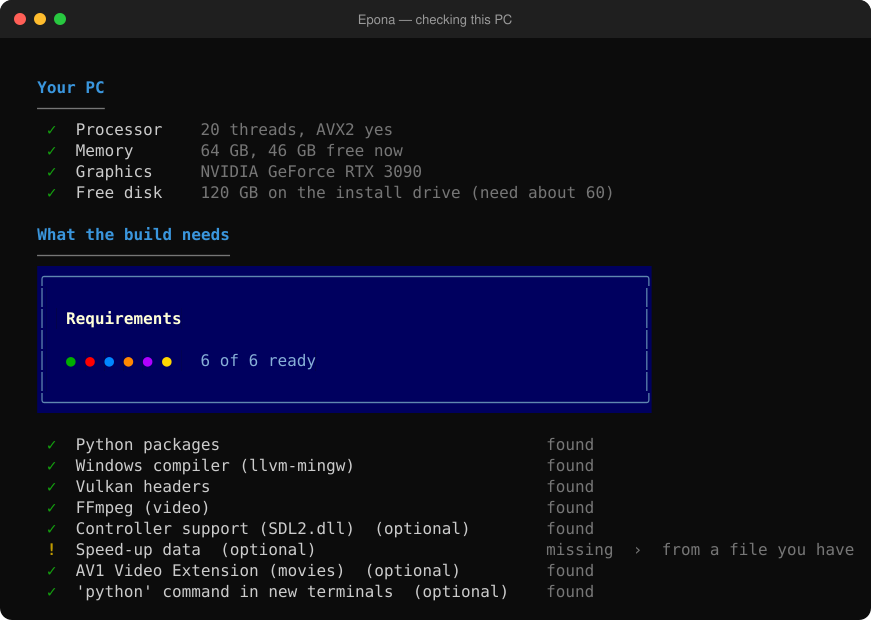
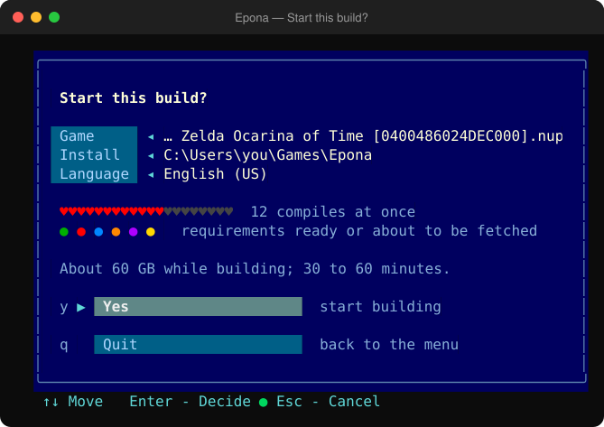
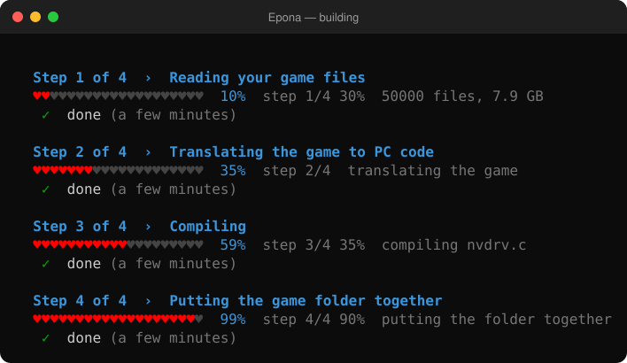
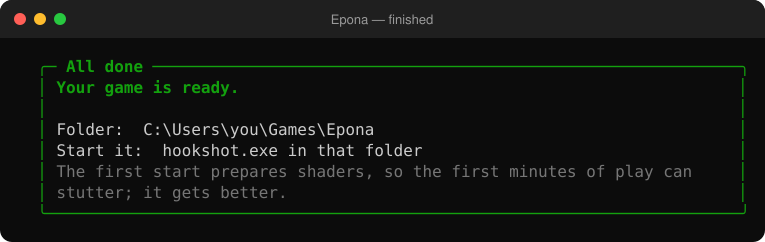

# What to expect

An honest walk through the first run, with what it costs and what can go wrong. Times are from one test PC (20 threads, 64 GB of memory,
an RTX 3090, an SSD) and are meant as a rough guide, not a promise.

> **Status:** built and played end to end **once**, by the maintainer, on one PC (Windows 11, an RTX 3090, 64 GB). That run drew with the
> Vulkan back end and went on for about an hour, and the maintainer reports it **played well**. It has not been tried on other hardware,
> so expect rough edges.
> See [`TRANSPARENCY.md`](TRANSPARENCY.md) for exactly what has and has not been run.

## Before you start

- **You must legally own the game**, as a `.nup` dump you made yourself ([`LEGAL.md`](LEGAL.md)). Epona contains and downloads no game files.
- **A PC that can run it:** Windows 10 or 11 (64-bit), a CPU with **AVX2**, a graphics card with **Vulkan 1.3 and mesh shaders**
  (NVIDIA RTX 20 / GTX 16 and newer, AMD RX 6000 and newer, Intel Arc), **16 GB of memory** or more, and **about 60 GB free** while
  building. Only NVIDIA has been tested by the original project; AMD and Intel reports are open on its issue page.
- **Python 3 (64-bit)** from python.org. Everything else is offered inside the menu.

## Starting it

Double-click **`epona.bat`**, or run `py -I nx2/make_game.py` in a terminal. Use the arrow keys and Enter (or type a choice's number or
letter); Esc cancels.

*Screens in this guide are drawn by the tool's own code from sample data, not photographs of a terminal.*

## The steps

### 1. Choose your game file

It looks for `.nup` files in your Downloads, Desktop and Documents and in a Downloads folder on each drive, or you can paste or drag in a path.

Then you pick the install folder (the standard one is `%USERPROFILE%\Games\Epona`) and the language.

### 2. It checks your PC and asks before fetching anything

The six medallions stand for what the build needs: Python packages, the compiler, the Vulkan headers, FFmpeg, controller support and the
AV1 movies extension. Anything missing is listed with its size and source, and you say yes or no to each. **Nothing downloads until you do.**

### 3. Confirm

One heart for each compile that will run at once, and the medallions again.

### 4. It builds

The hearts are one meter for the whole job, with the step beside them. You can use the PC meanwhile, but it will be busy, and **Ctrl+C is
always safe**: what is finished is kept, and choosing Start again carries on.

| Step | Roughly | What it is |
|---|---|---|
| Reading your game | 20 to 30 minutes | Extracting about 26 GB from the `.nup` (an estimate from file times) |
| Translating | about 3 minutes (measured: 165 s) | Turning the game's code into code for your PC |
| Compiling | **17 minutes** measured for the translated game and host, plus the Vulkan back end, which has **not been timed** | The long, hot step |
| Finishing | a few minutes (not timed) | Putting the game folder together |

**Plan on one to two hours the first time.** A second run reuses what was compiled and is much shorter: a rebuild with most of the work
already done took about 9 minutes on the test PC.

### 5. Done

## What it asks of your PC

- **Disk:** about 60 GB free while building. The finished folder is roughly 26 GB or more, because it holds the game's data.
- **Memory:** ten compiles at once used about 11 GB on the test PC. The menu suggests a number from your free memory and lets you type your own.
- **Processor:** busy, but not pinned; ten jobs averaged about half of 20 threads.

## The first time you play

- **Stutter at first** in each new area, while shaders are prepared. It improves the second time through.
- **Movies need Microsoft's free AV1 Video Extension**, or they show a green screen. The menu checks for it.
- **Controllers** need `SDL2.dll`; the menu offers it.
- Known problems on other hardware are listed on the original project's issue page: black screens after cutscenes, flicker on some AMD and
  Intel cards, and cards without mesh shaders cannot draw the world.

## If something goes wrong

- The menu shows the reason in a red panel, a hint, and the path of a log file (`%LOCALAPPDATA%\Epona\logs`).
- Common causes: a missing download you declined (choose Start again and say yes), too little disk space, or an antivirus removing a tool.
- Windows Defender may flag tools like these. Read [`TRANSPARENCY.md`](TRANSPARENCY.md) and decide for yourself.
- Still stuck: open an issue, and attach the log after looking it over (it contains your folder names).

## Removing it

Delete the install folder, `%LOCALAPPDATA%\Epona`, `%LOCALAPPDATA%\HookshotBuilder`, and in the project folder `work\` and `llvm-mingw\`.
If you said yes to the PATH question, your old PATH is saved in `work\user_path_before.txt`.
